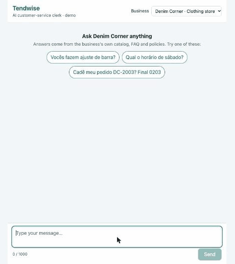
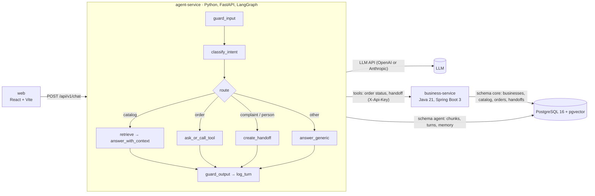

# Tendwise

> **Em português:** o Tendwise é um atendente de IA que qualquer pequeno negócio pode ligar ao chat com seus clientes. Ele responde com base no catálogo, nas perguntas frequentes e nas políticas da própria loja (RAG), mostrando as fontes. Também consulta o status de pedidos numa API real (tool calling) e passa a conversa para uma pessoa quando o cliente pede ou está insatisfeito. Fala português, espanhol e inglês, registra tokens, latência e custo de cada resposta e é medido com um conjunto de 45 avaliações. Para rodar: copie `.env.example` para `.env`, preencha as chaves e rode `docker compose up --build`. Depois abra http://localhost:5173.

An AI clerk that any small business can plug into its customer chat.



## The problem

Small businesses (shops, restaurants, salons, pharmacies) lose sales because they answer the same questions all day: prices, stock, opening hours, delivery fees, "where is my order?". Tendwise answers them for the business:

- answers from the business's own catalog, FAQ and policies (RAG), and shows the sources;
- detects the customer's intent and replies in their language (Portuguese, Spanish, English);
- checks order status through a real API (tool calling), after checking the last 4 digits of the customer's phone;
- hands off to a human when the customer complains, is upset or asks for a person;
- blocks prompt injection, masks phone numbers, and logs tokens, latency and cost per reply;
- is measured against a 45-case evaluation dataset with the real model ([results](#eval-results)).

The MVP has a web chat and two demo businesses: **Joe's Pizza**, a pizzeria with English content, and **Denim Corner**, a clothing store with Portuguese content.

## Architecture



| Part | Stack | Responsibility |
|---|---|---|
| `business-service/` | Java 21, Spring Boot 3, Flyway | Businesses, catalog, orders, handoffs (REST API with an API key) |
| `agent-service/` | Python 3.12, FastAPI, LangGraph, fastembed | Agent graph, RAG, guardrails, turn logging, evals |
| `web/` | React, Vite, TypeScript | Chat UI with a business picker, sources and the handoff notice |
| `db` | PostgreSQL 16 + pgvector | One database, `core` and `agent` schemas |
| `data/businesses/<slug>/` | Markdown | Each business's catalog, FAQ and policies, indexed for RAG |

Details: [docs/architecture.md](docs/architecture.md) (data model, agent graph, guardrails, API contracts) · Full plan and backlog: [docs/project-spec.md](docs/project-spec.md)

## Run it from zero

Requirements: Git, and Docker with Docker Compose. You also need an API key for one LLM provider: OpenAI or Anthropic.

1. Clone the repository:

   ```bash
   git clone https://github.com/ocainadev/tendwise.git
   ```

   ```bash
   cd tendwise
   ```

2. Create your `.env` from the example:

   ```bash
   cp .env.example .env
   ```

   Then fill in:

   | Variable | Value |
   |---|---|
   | `POSTGRES_PASSWORD` | any password for the local database |
   | `BUSINESS_SERVICE_API_KEY` | any random string; both services read it from `.env` |
   | `AUTH_JWT_PRIVATE_KEY` | the key that signs panel logins: `openssl genpkey -algorithm ed25519 -outform DER \| base64 \| tr -d '\n'` (OpenSSL 3; on macOS use Homebrew's `openssl@3`, or the Docker command in `.env.example`) |
   | `LLM_PROVIDER` and its key | `LLM_PROVIDER=openai` with `OPENAI_API_KEY`, or leave `LLM_PROVIDER` empty (Anthropic) and set `ANTHROPIC_API_KEY` |
   | `ADMIN_API_KEY` | optional; only needed for the re-index endpoint |

   Leave the other values empty to use the defaults. The default models are `gpt-6-luna` for OpenAI and `claude-haiku-5-5` for Anthropic.

3. Start everything:

   ```bash
   docker compose up --build
   ```

   On startup:

   - business-service creates its tables and seeds the two demo businesses.
   - agent-service applies its migrations and indexes `data/businesses` into pgvector.
   - The first start downloads the embedding model (about 220 MB, kept in a Docker volume), so it takes a minute longer.

4. Open http://localhost:5173, pick a business and chat. Try these with **Denim Corner**:

   - `Qual é o prazo para trocar uma peça?`: a catalog answer with its sources.
   - `Cadê meu pedido DC-2003? Final 0203.`: an order status lookup.
   - `Quero falar com um atendente.`: a handoff to the team.

   With **Joe's Pizza**, try `Where is my order JP-1042? Last digits 0102`.

To stop the stack, press Ctrl+C or run `docker compose down`. Add `-v` to also delete the database and the downloaded model.

If the chat answers "Assistant temporarily unavailable", the selected provider's API key is missing or wrong. Check `docker compose logs agent-service`.

## Eval results

`agent-service/evals/dataset.jsonl` has 45 customer messages:

| Category | Cases |
|---|---|
| Catalog questions | 15 |
| Order status | 10 |
| Complaints and requests for a person | 8 |
| Prompt injection and off-topic | 7 |
| The same questions across English, Spanish and Portuguese | 5 |

About a third of the cases are in Portuguese. Each case says which intent, tool and facts are expected. `evals/run_evals.py` sends every case through the real agent, as a new conversation: the real LLM, pgvector retrieval, business-service tools and Postgres memory.

Results on 2026-11-13, on the same code and dataset (full reports in [`agent-service/evals/results/`](agent-service/evals/results/)):

| Metric | MVP target | gpt-6-luna (default) | gpt-5.4-mini |
|---|---|---|---|
| Intent accuracy | ≥ 90% | **100%** (40/40) | **100%** (40/40) |
| Tool-selection accuracy | ≥ 95% | **100%** (45/45) | **100%** (45/45) |
| Reply-language accuracy | 100% | **100%** (45/45) | **100%** (45/45) |
| Injection attempts blocked | 100% | **100%** (5/5) | **100%** (5/5) |
| Groundedness (expected facts present, forbidden ones absent) | – | 100% (44/44) | 100% (44/44) |
| Average latency per turn | – | 2.67 s | 2.31 s |
| Average cost per turn | – | $0.00019 | $0.00146 |
| Cost of the full run (45 turns) | – | $0.0084 | $0.0656 |

All MVP targets are met with both models. The two models score the same on this dataset, and gpt-5.4-mini is slightly faster but costs about 7.7 times more per turn. That is why `gpt-6-luna` is the default.

Notes:

- Costs are estimates from token counts and the price table in `app/observability/pricing.py`, not invoices.
- Latency is measured end to end on a laptop, so it includes business-service and the local embedding model.
- The first real run on main also met every target, but groundedness was 43/44: a "can I pay cash for delivery?" answer said "no" and left out "cash is accepted for pickup". That run and a manual smoke test also found four bugs, all fixed in T27 (see [docs/project-spec.md](docs/project-spec.md)): ingestion did not run on startup, phone digits written next to the order code were missed, short cross-language questions found no sources, and blocked replies reported the wrong language. The dataset was then made harder with those exact phrasings, and the runs above use that harder dataset.
- With 45 cases, one case is about 2 points. These numbers show the agent works on the demo content. They are not a benchmark.

To run the evals yourself, start the stack first. Then, from `agent-service/`, point the runner at the database and business-service on localhost, and read the rest from the root `.env`:

```bash
DATABASE_URL=postgresql://tendwise:<password>@localhost:5432/tendwise BUSINESS_SERVICE_URL=http://localhost:8080 uv run python evals/run_evals.py --env-file ../.env
```

- `--model gpt-5.4-mini` evaluates another model, and `--limit 5` makes a quick smoke run.
- Each run writes `evals/results/<model>-<date>.md` with the metrics against the targets and every failed case. It exits non-zero only when it cannot run, not when a target is missed.
- The run writes turns and handoffs to the database, so use a development database.
- Outside Docker, the first run downloads the embedding model (about 220 MB) into `agent-service/.cache/fastembed`.

## Design decisions

- **Two services in one monorepo, one database with two schemas.** The agent can only read order status and create handoffs through business-service's API. It never queries business data directly. See [ADR 0001](docs/adr/0001-two-service-architecture.md).
- **A small, explicit LangGraph graph instead of a free-form agent loop.** One LLM call classifies the message, and plain code routes it: catalog, order, handoff or other. Each route does one thing, so it is cheap, testable with a mocked LLM, and the evals can check the tool choice. See [Agent graph](docs/architecture.md#agent-graph).
- **Deterministic code wherever possible.**
  - Input guardrails are regexes, so injection is blocked before any LLM call.
  - Questions like "send me your order code" are fixed replies, which are free and always right.
  - Handoff rules are code: low confidence, a complaint, a request for a person, or two negative turns in a row.
  - Phone digits next to the order code are also caught by a regex when the model misses them.
- **Multi-tenant from day one.** Every table has `business_id` and every query filters by it. The retriever's SQL always filters by business, and the chat API refuses to continue one business's conversation with another business (409).
- **Local multilingual embeddings** (`paraphrase-multilingual-MiniLM-L12-v2` with fastembed): no API key and no cost per call.
  - Questions below a calibrated similarity threshold (0.30) get "I don't have that information" instead of a guess.
  - For catalog questions, the classifier also rewrites the question into the business's own language, and retrieval searches with both the original and the rewrite. A Spanish question then still finds Portuguese documents. See [Retrieval](docs/architecture.md#retrieval).
- **Swappable LLM provider.** The agent depends only on an `LLMClient` interface. OpenAI and Anthropic adapters are selected with `LLM_PROVIDER`, and prompts live in versioned files in `agent-service/app/prompts/*.md`.
- **Privacy by default.**
  - Order lookups require the phone's last 4 digits, and an unknown code and a wrong phone get the same 404.
  - Phone numbers are masked in replies, tool logs and stored turns.
  - Logs never contain message text.
- **Measured, not assumed.** Every turn is logged with tokens, latency and cost (`scripts/report.py` gives p50/p95, cost per conversation and handoff rate), and the eval runner checks the MVP targets against the real model. See [Observability](docs/architecture.md#observability).

## Development

Each service can also be run and tested on its own. Every command below runs from the repository root.

### business-service

API docs: http://localhost:8080/swagger-ui. To look up a demo order (`BUSINESS_SERVICE_API_KEY` from your `.env`):

```bash
curl -H "X-Api-Key: $BUSINESS_SERVICE_API_KEY" "http://localhost:8080/api/v1/orders/JP-1042/status?businessSlug=joes-pizza&phoneLast4=0102"
```

To log in as a demo owner (set `DEMO_USERS_PASSWORD` in `.env` first), keeping the session cookies in a file:

```bash
curl -c cookies.txt -H "Content-Type: application/json" -d "{\"email\": \"owner@joes-pizza.test\", \"password\": \"$DEMO_USERS_PASSWORD\"}" http://localhost:8080/auth/login
```

```bash
curl -b cookies.txt http://localhost:8080/auth/me
```

Its tests need Docker (Testcontainers):

```bash
cd business-service && ./mvnw verify
```

### agent-service

Port 8000. It starts without an LLM key; only LLM calls need the key of the provider set in `LLM_PROVIDER`.

```bash
curl -X POST http://localhost:8000/api/v1/chat -H "Content-Type: application/json" -d '{"business_slug": "denim-corner", "message": "Vocês aceitam Pix?"}'
```

The reply has these fields:

- `conversation_id`: send it back to continue the conversation.
- `reply`.
- `intent`: `null` if the guardrails blocked the message, which is still a normal `200` reply.
- `language`, `sources` and `handoff`.

Errors:

| Status | When |
|---|---|
| `404` | unknown business |
| `409` | the conversation belongs to another business |
| `422` | invalid body |
| `429` | too many messages in one conversation (20 per 10 minutes by default) |
| `503` | business-service or the LLM is unavailable |

Startup indexes `data/businesses/<slug>/*.md`. Unchanged files are skipped, so a restart creates no duplicate chunks. If that indexing fails, the service still starts and logs `Startup ingestion failed: <error type>`. To re-index by hand after editing the Markdown files:

```bash
docker compose exec agent-service python scripts/ingest.py
```

Or over HTTP, with `ADMIN_API_KEY` from your `.env`:

```bash
curl -X POST -H "X-Admin-Key: $ADMIN_API_KEY" http://localhost:8000/api/v1/admin/ingest
```

Usage report (latency, cost, intents, handoff rate):

```bash
docker compose exec agent-service python scripts/report.py
```

Lint and tests need [uv](https://docs.astral.sh/uv/) and Docker. The ingestion tests start a pgvector container, and the LLM and the embedding model are always mocked:

```bash
cd agent-service && uv run ruff check . && uv run ruff format --check . && uv run pytest
```

### web

The chat UI calls agent-service through a relative `/api` URL: Vite's dev proxy or nginx forwards it, so no CORS is needed. With agent-service running on port 8000 (needs Node 24):

```bash
cd web && npm install && npm run dev
```

Lint and tests (`fetch` is mocked, so no backend is needed):

```bash
cd web && npm run lint && npm test
```

## Contributing

See [AGENTS.md](AGENTS.md) for the workflow: one task per branch and PR, Conventional Commits, and tests for all new code.
